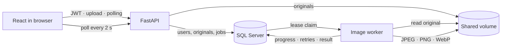

# Image by image · Image Processing Service

**Upload an image. Arrange a sequence. Pick up the result when it is ready.**

This portfolio project implements an asynchronous image-processing service. The API accepts uploads and records jobs in SQL Server; a separate worker transforms each original and makes the result available for download. The project runs locally with Docker Compose and is not deployed as an internet service.

[Versión en español](README.md) · [roadmap.sh project](https://roadmap.sh/projects/image-processing-service)

## Workflow

1. Register or sign in. The API issues a JWT access token.
2. Upload a JPEG, PNG, or WebP original. It is preserved and added to your private library.
3. Select an image, add transformations, and arrange their order.
4. The API responds with `202 Accepted` and a job in `queued` state.
5. A separate worker claims the row, applies the sequence, and saves the result. The UI polls the job every two seconds.
6. Download the result from recent jobs or through the API.

## Features

- Account registration and sign-in with Argon2 password hashing and short-lived JWT access tokens.
- Per-user isolation for images, jobs, and downloads.
- JPEG, PNG, and WebP uploads, limited to 20 MB.
- Ordered crop, proportional resize, text watermark, and JPEG/PNG/WebP conversion.
- Paginated original list (`page`, `limit`) and job status endpoint.
- Durable SQL Server queue with expiring leases and a heartbeat during image processing.
- Per-user idempotency through `Idempotency-Key`; a reused key with a different request returns `409`.
- Up to three transient retries, with backoff delays of 5, 10, and 20 seconds.
- Temporary output followed by an atomic replace; only the current lease owner can complete the job row.
- Responsive Spanish UI and bilingual documentation.

## Architecture



SQL Server is both the source of durable records and the queue. A row tracks status, attempt count, availability time, and a lease token/expiry. On SQL Server, a worker claims a row with update locks while skipping rows claimed by another worker. If a process stops, another worker can claim the same row after its lease expires.

Each attempt writes to a temporary file in the shared volume and uses `os.replace` to publish the output atomically. The current lease token is also required to finish the database row, so an old worker cannot change status after losing its claim. The result path is stable per job ID; retrying replaces the same output instead of creating another result.

## Run locally

Requirements: Docker Desktop with Docker Compose v2 enabled.

```powershell
Copy-Item .env.example .env
```

Edit `.env` and replace `SQLSERVER_PASSWORD` and `JWT_SECRET` before sharing the machine or storing real data. The SQL Server password must meet its complexity rules. Generate a JWT secret in PowerShell:

```powershell
[Convert]::ToBase64String([Security.Cryptography.RandomNumberGenerator]::GetBytes(48))
```

Paste the generated value into `.env` as `JWT_SECRET`, then start the services:

```powershell
docker compose up --build
```

Open the UI at [http://localhost:5173](http://localhost:5173), interactive API docs at [http://localhost:8000/docs](http://localhost:8000/docs), or the health endpoint at [http://localhost:8000/health](http://localhost:8000/health).

Compose starts SQL Server and waits for its TCP endpoint, creates the application database, and runs migrations before starting the API. The API and worker share the local image volume. Named volumes retain data when containers stop through `Ctrl+C` or `docker compose down`; `docker compose down -v` removes the database and saved images.

## API

Protected routes require `Authorization: Bearer <token>`.

| Method and route | Purpose |
| --- | --- |
| `POST /auth/register` | Create an account |
| `POST /auth/login` | Get a JWT |
| `POST /images` | Upload an original (`multipart/form-data`, field `file`) |
| `GET /images?page=1&limit=8` | List your originals |
| `GET /images/{id}` | Read metadata |
| `GET /images/{id}/original` | Download the original |
| `POST /images/{id}/transform` | Create a job; requires `Idempotency-Key` |
| `GET /jobs/{id}` | Read status and attempt count |
| `GET /jobs/{id}/result` | Download the completed result |

Example sequence. Operations run in the order sent:

```json
{
  "operations": [
    { "type": "crop", "x": 0, "y": 0, "width": 900, "height": 700 },
    { "type": "resize", "width": 1200, "height": 1200 },
    { "type": "watermark", "text": "My mark", "position": "bottom-right" },
    { "type": "format", "format": "webp" }
  ]
}
```

A job can be `queued`, `processing`, `succeeded`, or `failed`. Out-of-bounds crops and invalid operations fail permanently. Transient failures retry up to three times after the initial attempt. Reusing an idempotency key returns the same job; changing the request body returns `409 Conflict`.

## Demonstrate worker recovery

This walkthrough creates a repeatable interruption while a job has an active lease. Use the local environment only:

1. In `.env`, set `WORKER_DEMO_PAUSE_SECONDS=30`, `WORKER_LEASE_SECONDS=12`, and `WORKER_HEARTBEAT_SECONDS=3`.
2. Apply the settings: `docker compose up -d --force-recreate api worker`.
3. Submit a transformation in the UI. When it shows `processing`, the worker is paused and the row has a lease.
4. Stop the worker: `docker compose stop worker`. The SQL Server job row remains.
5. Wait 12 seconds for the lease to expire, then start it again: `docker compose start worker`.
6. The same job is claimed with a new token and continues as attempt 2. The UI shows progress and then enables the result.
7. Repeat a request using the same `Idempotency-Key`: the API returns the same job ID. A per-user unique constraint prevents a duplicate row.
8. Restore the three settings in `.env` to their usual values (`0`, `60`, `15`) and recreate the API and worker.

`WORKER_DEMO_PAUSE_SECONDS` is a teaching switch that defaults to zero. It does not change the normal worker path. A permanent failure, such as an invalid crop, moves directly to `failed` without spending the remaining attempts.

## Development and verification

Backend (Python 3.12 or 3.13):

```powershell
cd backend
uv sync --extra dev
uv run python -m pytest
uv run ruff check app tests migrations
uv run alembic upgrade head
uv run alembic check
```

Tests use temporary SQLite databases for authentication, per-user privacy, pagination, all four transformations, idempotency, expired-lease recovery, transient retries, and permanent errors. Docker Compose uses SQL Server for the full local demo.

Frontend:

```powershell
cd frontend
npm ci
npm run build
```

## Scope

This is a local portfolio demo for code review. The service is not publicly hosted and does not include cloud storage. Uploads stay outside Git in a Docker volume; `.env` and local data are ignored. API access uses short-lived tokens and scopes resources to each account.

This repository has no `LICENSE` file; public visibility alone does not grant general permission to reuse or distribute the code.
