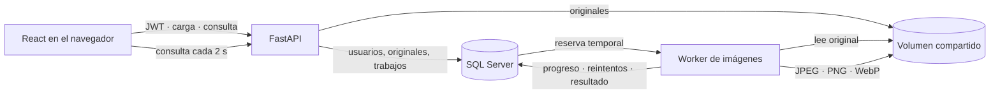

# Imagen por imagen · Servicio de procesamiento de imágenes

**Sube una imagen. Arma una secuencia. Recoge el resultado cuando esté listo.**

Este proyecto implementa un servicio de procesamiento de imágenes asíncrono para portafolio. La API acepta la carga y registra el trabajo en SQL Server; un worker separado transforma el original y deja el resultado disponible para su descarga. El proyecto se ejecuta en local con Docker Compose y no incluye un servicio alojado en internet.

[English version](README.en.md) · [Proyecto de roadmap.sh](https://roadmap.sh/projects/image-processing-service)

## Recorrido

1. Crea una cuenta o inicia sesión. La API entrega un token JWT.
2. Sube un original JPEG, PNG o WebP. El original se conserva y queda en tu biblioteca privada.
3. Selecciona una imagen, agrega transformaciones y ordénalas.
4. La API responde `202 Accepted` con un trabajo en estado `queued`.
5. El worker toma la fila, aplica la secuencia y guarda el resultado. La interfaz consulta el trabajo cada dos segundos.
6. Descarga el resultado desde la biblioteca de trabajos o mediante la API.

## Funciones

- Registro e inicio de sesión con contraseña almacenada con Argon2 y JWT de acceso.
- Imágenes, trabajos y descargas separados por usuario.
- Carga limitada a 20 MB y a JPEG, PNG o WebP.
- Transformaciones ordenadas: recorte, escala proporcional, marca de agua de texto y formato JPEG/PNG/WebP.
- Listado de originales paginado (`page`, `limit`) y consulta de trabajo.
- Cola durable implementada en SQL Server, con reservas temporales y latido durante la transformación.
- Idempotencia por usuario con `Idempotency-Key`; una clave repetida con otro contenido devuelve `409`.
- Hasta tres reintentos transitorios, con espera creciente de 5, 10 y 20 segundos.
- Escritura temporal y reemplazo atómico del resultado; la reserva vigente decide qué worker puede completar el estado.
- Interfaz responsive en español; la documentación está en español e inglés.

## Arquitectura



SQL Server cumple dos funciones: conserva los datos y actúa como cola durable. La fila guarda el estado, el número de intento, la hora de disponibilidad y una reserva con token y vencimiento. En SQL Server, el worker reclama una fila con bloqueo de actualización y omite filas que otro worker ya reservó. Si el proceso cae, otro worker puede reclamar el mismo trabajo cuando vence la reserva.

Cada intento escribe en un temporal dentro del volumen y usa `os.replace` para publicar el resultado atómicamente. El token de reserva también se exige al completar la fila: un worker antiguo no puede cambiar el estado después de perder el trabajo. El destino usa el ID estable del trabajo, por lo que repetir la transformación reemplaza el mismo resultado en vez de crear otro.

## Ejecutar localmente

Requisitos: Docker Desktop con Docker Compose v2 habilitado.

```powershell
Copy-Item .env.example .env
```

Edita `.env` y reemplaza `SQLSERVER_PASSWORD` y `JWT_SECRET` antes de compartir el equipo o guardar datos reales. La contraseña de SQL Server debe cumplir sus reglas de complejidad. Puedes generar un secreto para JWT desde PowerShell:

```powershell
[Convert]::ToBase64String([Security.Cryptography.RandomNumberGenerator]::GetBytes(48))
```

Pega el valor generado como `JWT_SECRET` en `.env`, y luego inicia los servicios:

```powershell
docker compose up --build
```

Abre la interfaz en [http://localhost:5173](http://localhost:5173), la documentación interactiva en [http://localhost:8000/docs](http://localhost:8000/docs) o la comprobación de salud en [http://localhost:8000/health](http://localhost:8000/health).

Compose inicia SQL Server, espera a que acepte conexiones, crea la base y ejecuta las migraciones antes de arrancar la API. El worker y la API comparten el volumen local de imágenes. Los volúmenes nombrados conservan los datos al detener los contenedores con `Ctrl+C` o `docker compose down`; `docker compose down -v` elimina la base y las imágenes guardadas.

## API

Las rutas protegidas requieren `Authorization: Bearer <token>`.

| Método y ruta | Uso |
| --- | --- |
| `POST /auth/register` | Crear cuenta |
| `POST /auth/login` | Recibir token JWT |
| `POST /images` | Subir un original (`multipart/form-data`, campo `file`) |
| `GET /images?page=1&limit=8` | Listar tus originales |
| `GET /images/{id}` | Consultar metadatos |
| `GET /images/{id}/original` | Descargar original |
| `POST /images/{id}/transform` | Crear un trabajo, requiere `Idempotency-Key` |
| `GET /jobs/{id}` | Consultar estado y número de intento |
| `GET /jobs/{id}/result` | Descargar el resultado al completarse |

Ejemplo de secuencia. Las acciones se ejecutan en el orden enviado:

```json
{
  "operations": [
    { "type": "crop", "x": 0, "y": 0, "width": 900, "height": 700 },
    { "type": "resize", "width": 1200, "height": 1200 },
    { "type": "watermark", "text": "Mi marca", "position": "bottom-right" },
    { "type": "format", "format": "webp" }
  ]
}
```

Un trabajo puede estar `queued`, `processing`, `succeeded` o `failed`. Los recortes fuera de los límites y las operaciones inválidas fallan permanentemente. Los errores transitorios se reintentan hasta tres veces después del intento inicial. Una clave de idempotencia repetida devuelve el mismo trabajo; si cambia el contenido de la solicitud, la API responde `409 Conflict`.

## Demostrar la recuperación del worker

Este recorrido provoca una interrupción reproducible mientras un trabajo tiene una reserva activa. Hazlo solo con el entorno local:

1. En `.env`, cambia a `WORKER_DEMO_PAUSE_SECONDS=30`, `WORKER_LEASE_SECONDS=12` y `WORKER_HEARTBEAT_SECONDS=3`.
2. Aplica la nueva configuración: `docker compose up -d --force-recreate api worker`.
3. Desde la interfaz, envía una transformación. Cuando veas el estado `processing`, el worker está en la pausa de demostración y la fila ya tiene una reserva.
4. Detén el worker: `docker compose stop worker`. El registro del trabajo sigue en SQL Server.
5. Espera 12 segundos para que venza la reserva y vuelve a iniciarlo: `docker compose start worker`.
6. El mismo trabajo se reclama con un nuevo token y continúa como intento 2. La interfaz muestra el estado y luego habilita el resultado.
7. Repite una solicitud con la misma `Idempotency-Key`: la API debe devolver el mismo ID de trabajo. La restricción única por usuario evita una segunda fila.
8. Devuelve las tres opciones a sus valores normales en `.env` (`0`, `60`, `15`) y recrea API y worker.

`WORKER_DEMO_PAUSE_SECONDS` es un interruptor didáctico que por defecto vale cero. No cambia la ruta normal de producción del worker. En un fallo permanente, por ejemplo un recorte inválido, el trabajo pasa a `failed` sin gastar los intentos restantes.

## Desarrollo y verificación

Backend (Python 3.12 o 3.13):

```powershell
cd backend
uv sync --extra dev
uv run python -m pytest
uv run ruff check app tests migrations
uv run alembic upgrade head
uv run alembic check
```

Las pruebas usan SQLite temporal para comprobar autenticación, privacidad por usuario, paginación, las cuatro transformaciones, claves idempotentes, recuperación de una reserva vencida, reintentos y errores permanentes. Docker Compose utiliza SQL Server para que la demo recorra la configuración prevista.

Frontend:

```powershell
cd frontend
npm ci
npm run build
```

## Alcance

La aplicación es una demo local para revisión de portafolio. No hay despliegue público del servicio ni configuración de almacenamiento en la nube. Las cargas quedan fuera de Git en un volumen Docker; `.env` y datos locales están ignorados. El acceso a la API usa tokens breves y protege los recursos por cuenta.

Este repositorio no incluye un archivo `LICENSE`; la visibilidad pública no concede por sí sola permiso general para reutilizar o distribuir el código.
